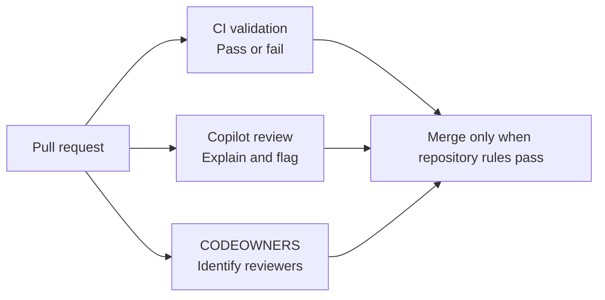

Howdy Folks,

Ask any engineering organisation that has adopted GitHub Copilot, Claude Code, or Cursor how many copies of its "review my Bicep" skill exist. The honest answer is often: more than one, and nobody is sure which copy is current.

Teams write their own agents, skills, and prompts. Those copies drift, quality varies, and the same work gets repeated. There's a more serious cost, too: shared agent instructions and MCP (Model Context Protocol) server definitions can influence what a tool does and what it can access. An unreviewed plugin deserves the same care as any other dependency you bring into your development environment.

I wanted one place to publish and discover these assets without asking every team to fork and maintain its own copy. So I built [agentz](https://github.com/azurewithdanidu/agentz), a GitHub repository designed to act as a plugin marketplace for VS Code, GitHub Copilot CLI, Claude Code, and Cursor.

In this post, I'll walk through the design, the compatibility detour I had to undo, and the quality gate I use to keep submissions reviewable. The goal isn't to pretend that four clients behave identically. It's to keep the shared content in one place and make the differences explicit.

Let's dive in!

---

## The repository is the marketplace

The basic idea is deliberately unremarkable: a Git repository holds the plugin catalog and its source content. There is no separate package registry to operate, and users can install only the plugins they need.

For example, the Copilot CLI install flow looks like this:

```bash
copilot plugin marketplace add azurewithdanidu/agentz
copilot plugin install bicep-avm-review@agentz
```

The exact discovery and install flow differs by client. VS Code has plugin marketplace settings, Copilot CLI has marketplace commands, Claude Code uses its plugin marketplace, and Cursor supports team marketplaces. Check each client's current docs before rolling this out: these features and their availability continue to change.

* [VS Code agent plugins](https://code.visualstudio.com/docs/agent-customization/agent-plugins)
* [Find and install GitHub Copilot CLI plugins](https://docs.github.com/en/copilot/how-tos/copilot-cli/customize-copilot/plugins-finding-installing)
* [Claude Code plugin marketplaces](https://code.claude.com/docs/en/plugins)
* [Cursor plugins](https://cursor.com/docs/plugins)

The repository has one marketplace catalog per client where required, but the plugin's authored content stays in a canonical location. For example, the Copilot CLI catalog lives at `.github/plugin/marketplace.json`, while Claude Code uses `.claude-plugin/marketplace.json`. These files describe how each client discovers the catalog; they aren't copies of each skill's behavior.

## One source, client-aware manifests

The tricky part is that "plugin" doesn't mean exactly the same package layout in every tool. A plugin format can be recognized by multiple clients without every component being supported in the same way.

In `agentz`, the root `plugin.json` is the source manifest. The repository keeps plugin content in folders such as `skills/`, `agents/`, and `commands/`, with MCP server configuration alongside it. Scripts generate the client-specific manifests and marketplace copies:

| Client      | Plugin source and marketplace catalog                           | How agentz handles it                    |
|-------------|-----------------------------------------------------------------|------------------------------------------|
| VS Code     | `plugin.json`                                                   | Uses the legacy Copilot plugin layout    |
| Copilot CLI | `plugin.json`; `.github/plugin/marketplace.json`                | Reads the plugin and generated catalog   |
| Claude Code | `.claude-plugin/plugin.json`; `.claude-plugin/marketplace.json` | Generates Claude-specific metadata       |
| Cursor      | `.cursor-plugin/plugin.json`; `.cursor-plugin/marketplace.json` | Generates Cursor metadata and MCP config |

The source files and generated files are intentionally easy to tell apart. The generated manifests are not edited by hand. If one goes stale, the fix is to update the source and rerun the generator.

```bash
python3 scripts/sync_manifests.py
python3 scripts/build_catalog.py
python3 scripts/validate_repo.py
```

The first command synchronizes client manifests, the second rebuilds `catalog.json` and the README plugin table, and the third runs the repository checks. CI also checks that generated outputs match their sources.

### The Agent Plugins detour

I initially moved the marketplace to Agent Plugins 1.0, an open specification published in September 2026. That format is useful, but it wasn't the right fit for this particular cross-client layout.

The standard defines portable skills and MCP configuration, with other components handled through client-specific extensions. In Copilot's Agent Plugins layout, agents and commands live in a Copilot namespace. Claude Code and Cursor have their own plugin formats and component conventions. That means "supports the plugin format" does not promise that every client will load every component the same way.

I wanted the clients I was targeting to read the shared skills and agent content using their existing conventions, and to generate only the manifests needed to connect those files to each client. In this repository, adding the Agent Plugins `$schema` selects different Copilot semantics and stops the Copilot clients from reading the legacy root `agents/` folder. The validator rejects that schema because it conflicts with this repository's chosen layout. That's a project-level design rule, not a universal restriction on the specification.

The [Agent Plugins 1.0 specification](https://github.com/agentplugins/agent-plugins-spec/blob/main/spec/1.0.0.md) describes the format; [VS Code's format reference](https://code.visualstudio.com/docs/agents/reference/agent-plugin-reference) explains how its clients interpret the different layouts. Cursor also documents support for Agent Plugins, but that still doesn't make all plugin components portable. I keep this distinction front and centre: common packaging is useful, but actual component support is client-specific.

## Put reusable logic in skills

The most useful design rule I landed on is to put reusable workflow logic in skills, then keep agents and commands as thin entry points where a client supports them.

An agent might identify which skill applies and pass along the user's files or request. The skill contains the repeatable workflow. That gives the same core logic a better chance of being useful across clients that support the [Agent Skills format](https://code.visualstudio.com/docs/agent-customization/agent-skills), without claiming that all agent and command definitions are interchangeable.

The description matters, too. Compare these:

* Weak: "Helps with Bicep."
* Better: "Review Bicep templates against Azure Verified Modules. Use when someone asks to review Bicep or check AVM compliance. Do not use for Terraform or deployment requests."

The second description says what the skill does, when it applies, and when it doesn't. In my experience, that clarity makes it easier for both the client and the person browsing the catalog to choose the right skill.

Skills also benefit from progressive loading. Keep `SKILL.md` focused on the entry point and workflow, then move supporting detail into `references/`, `templates/`, or `scripts/` where it belongs. That keeps the core instruction readable and avoids repeating the same rules in several places.

## Make publishing a workflow, not a free-for-all

I built the publishing framework as a plugin too. It takes a contributor through four steps:

1. Analyse the request and agree what the plugin should do.
2. Search the catalog for an existing skill or plugin before creating another one.
3. Scaffold and build the plugin, keeping reusable logic in skills.
4. Validate the structure and evals before opening a pull request.

The repository's `catalog.json` indexes its plugins, skills, agents, and commands. The publishing workflow checks it before scaffolding, because catching a duplicate before writing it is cheaper than reconciling two competing copies later.

The build and validation steps can integrate with HVE Core's builder and Vally eval tooling when available. They also have built-in paths for contributors who aren't using those tools. The repository's publishing gate is designed to work without requiring HVE Core.

## Evals should check both "do" and "don't"

Each plugin includes a Vally eval specification. The validator requires at least ten stimuli overall, three or more positive skill-invocation cases, and two or more negative cases for nearby requests that should not trigger it. Every skill needs a positive case, and referenced fixtures must exist.

The negative cases are important. A skill that triggers on every vaguely related request isn't doing its job. A useful eval set should test the task, the common failure modes, and the boundaries of when the skill should stay out of the way.

CI runs `vally lint` to check the eval specification. The workflow can also run the eval suite against a model when the required `COPILOT_GITHUB_TOKEN` secret is available. If that token is missing, the eval job currently warns and skips successfully. So the eval suite is not an unconditional merge blocker by itself; configure your repository's required checks and secrets deliberately if you need that guarantee.

## The gate: CI decides, Copilot explains, people approve

For a real marketplace, the quality gate matters as much as the catalog. I split the responsibilities across three layers:



CI handles deterministic pass/fail rules. It checks manifests, plugin naming and versioning, MCP configuration, agent and skill metadata, eval structure, secrets, generated files, and links. The workflow also runs Anthropic's plugin validator.

Copilot code review has a different job: it can explain a problem early and point a contributor to the rule and its fix. It is not a substitute for a blocking CI check. In `agentz`, path-specific instructions cover plugin submissions, manifests, skills, agents, and evals.

The [CODEOWNERS file](https://docs.github.com/en/repositories/managing-your-repositorys-settings-and-features/customizing-your-repository/about-code-owners) identifies the people responsible for reviewing marketplace changes. But a CODEOWNERS file alone does not force an approval; repository rules need to require the appropriate reviews and checks. That distinction matters when you are describing a gate as something that actually blocks a merge.

### Don't trust review instructions as the only control

There is a subtle weakness in repository-based review instructions: the same pull request can change review instructions and scripts. Treat changes to review policy as privileged, not as ordinary plugin edits. A prompt or instruction file is useful guidance, but it isn't an independent security boundary.

I added a dedicated instruction for changes to `.github/` and `scripts/`, and CODEOWNERS assigns those sensitive paths to the marketplace owner. The rule flags the change; the required human approval is what provides the independent check. Keep enforcement in repository settings, not just in a document describing the intended process.

## Catch duplicates without pretending a score is a verdict

The catalog check compares new skill descriptions with existing entries and raises a similarity warning for likely duplicates. I started with Jaccard similarity, but it missed a short description that was largely contained within a longer one. An overlap coefficient was a better fit for that particular check.

The check warns; it doesn't automatically reject the contribution. Similar wording can describe different workflows, and different wording can still hide duplicated behavior. A person who understands the use case should make the final call.

## Verify the platform, not the blog post

Before settling on this design, I fact-checked sixteen assumptions about the plugin ecosystem. Seven were confirmed, five were partly right, and four were wrong. That exercise changed the shape of the solution.

The lesson wasn't that one format is bad and another is good. It was that platform behavior is more nuanced than a compatibility table often suggests. A published spec isn't the same as every client shipping every feature as generally available. A marketplace Git ref isn't the same as a plugin's semantic version. And a client recognizing a manifest doesn't prove that each component works at runtime.

So let's cut to the chase: test the actual plugin in the actual clients and versions you plan to support. Keep the compatibility matrix close to the code, and re-check it before publishing. The repository's generators and validators show the intended packaging; they don't replace installation and runtime tests in each client.

## Takeaways

* Use one repository as the catalog and canonical home for shared plugin content.
* Keep authored behavior in one place and generate client-specific metadata where needed.
* Treat skills as reusable workflow content; handle agents, commands, and MCP configuration according to each client's documented support.
* Put merge-blocking rules in CI and repository settings, use Copilot review for explanations, and require owners to approve sensitive changes.
* Test in each target client. Similar manifests are not proof of identical behavior.

The marketplace is public at [azurewithdanidu/agentz](https://github.com/azurewithdanidu/agentz). Feel free to explore the generators, validator, eval specs, and publishing workflow, then adapt the pattern to your organisation.

Hope this will help someone in need. Until next time, feel free to reach out if you have any questions!
